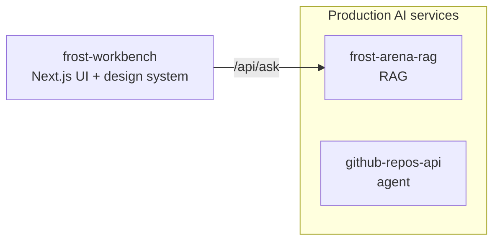

# Hi, I'm Evan 👋

**AI / LLM Engineer with a frontend-developer background.** I build
production-grade AI systems end to end — the full journey from "works on my
machine" to **evaluated, observable, guarded, and deployed** — across
Python/FastAPI services, a Next.js frontend, and the retrieval, agent, and
evaluation plumbing in between.

## 🧊 Featured work — one connected full-stack AI product

| Project | What it is | Live |
|---|---|---|
| **[frost-arena-rag](https://github.com/FrostBlazeX/frost-arena-rag)** | Production **RAG** service — hybrid retrieval (pgvector + Postgres full-text + RRF) → LLM reranking → input/output guardrails → generation. Re-runnable eval harness + **blocking CI gate**, Langfuse tracing, deployed on Render. | [▶](https://frost-arena-rag.onrender.com/docs) |
| **[github-repos-api](https://github.com/FrostBlazeX/github-repos-api)** | Production **tool-using agent** — multi-tool function calling over SQLite, opt-in planning, session memory, injection + schema guardrails, CI eval gate. | [▶](https://github-repos-api-lbg6.onrender.com/docs) |
| **[frost-workbench](https://github.com/FrostBlazeX/frost-workbench)** | The **Next.js frontend + design system** that consumes the RAG service through a server-side API proxy — with cold-start handling, error/retry, and abort. | [▶](https://frost-workbench.vercel.app) |

## What I care about

- **Evals before features.** Retrieval and answer quality get a re-runnable
  harness and a CI gate that *blocks the build* on failure — no shipping on vibes.
- **Measure the trade-off, don't guess it.** Adding a reranker, the eval showed
  the *small* model matched the big one at ~3× lower latency — so I shipped the
  small one. The data decides, not intuition.
- **Honest results.** I document what *didn't* work — hybrid search regressing
  semantic queries, two questions retrieval genuinely can't reach — as carefully
  as the wins.

## 🛠 Stack

`Python` · `FastAPI` · `TypeScript` · `Next.js` · `React` · `Tailwind CSS`
· `Postgres / pgvector` · `Supabase` · `SQLite` · `pandas` · `Langfuse`
· `Promptfoo` · `Groq / OpenAI` · `Render` · `Vercel`

## 📫 Connect

[LinkedIn](https://www.linkedin.com/in/evan-ohemi-bb2620410)
